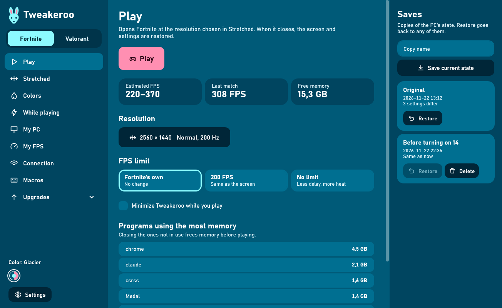
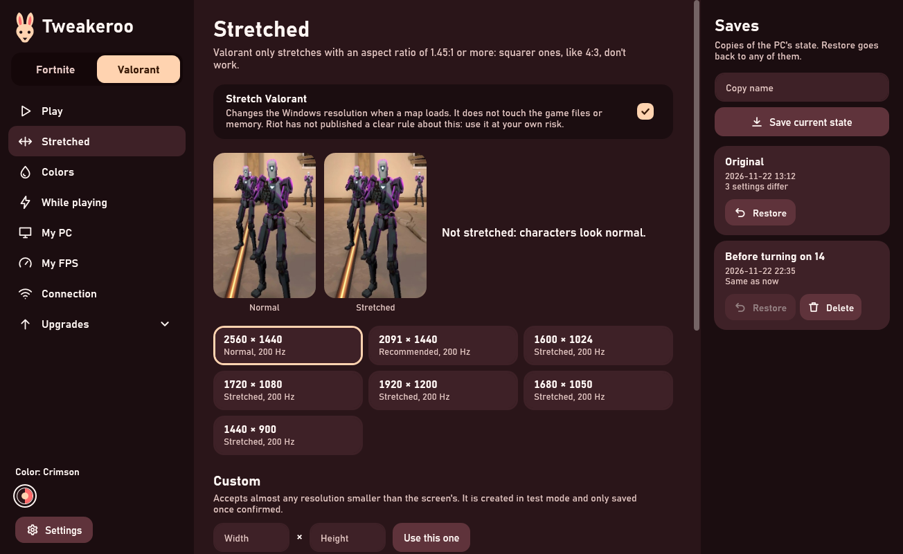
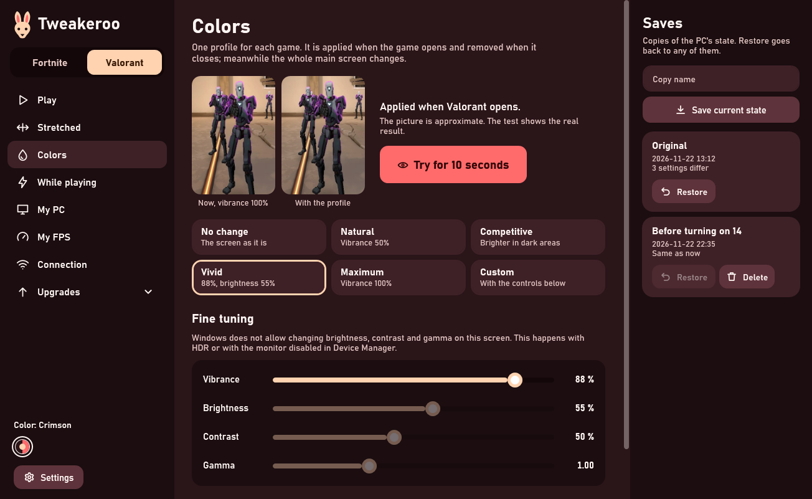
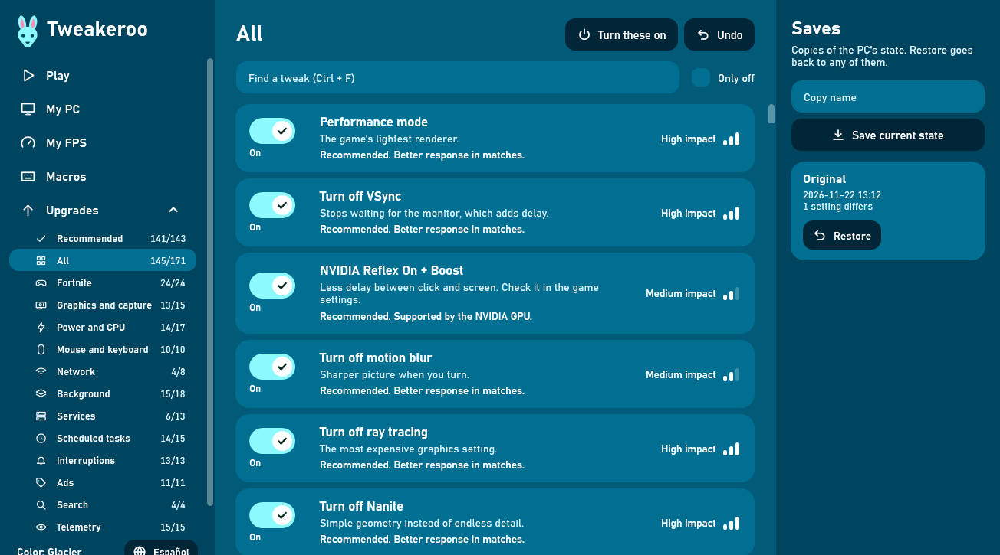

<p align="center"></p>

<h1 align="center">Tweakeroo</h1>

<p align="center">A free Windows app that tunes your PC for Fortnite, Valorant and Counter-Strike 2, opens the game in stretched resolution and lets you undo every tweak.</p>

<p align="center"><a href="https://github.com/benjarn114/tweakeroo/releases/latest/download/Tweakeroo.exe"><b>Download Tweakeroo.exe</b></a> · <a href="https://github.com/benjarn114/tweakeroo/releases">All versions</a></p>



## What it is

Tweakeroo is a single `.exe` with more than 200 Windows and game settings, each with its own switch. It scans your components, tells you which settings suit your PC and why, and saves a copy of your original state before it changes anything.

I vibe-coded it: I had the ideas, tested it on my own PC, and built it with AI. Making it cost me little, so I'm giving it away. There are no ads, no accounts, no analytics and no locked features.

Since 1.0, Tweakeroo is out of early access.

## What it does

### One app, three games
- Switch between Fortnite, Valorant and Counter-Strike 2 and the whole app follows: colors, photos, resolution, FPS, tweaks and color profile. It can also switch by itself when a game opens.

### Themes
- Night, Rain and Arcade: an animated pixel art background with its own music and colors. Pick one at the bottom left.
- Simple keeps the usual colors per game with no animated background, for the best performance.
- The background stops while the app is minimized, in the background or with a game open, and stays still when animations are off.

### Play
- One button opens the game at the resolution you picked. When it closes, your screen and Fortnite's settings are restored.
- FPS limit, estimated FPS, your last match and the programs using the most memory.

### Stretched Resolution
- Its own section in every game. Your monitor's resolution by default. Pick a stretched one from the dropdown, sorted from least to most stretched, or make your own on NVIDIA cards; nothing needs to be created in the NVIDIA panel. A new one is tested first: if you don't confirm it within 15 seconds, it goes back.
- Before and after photos show how much wider characters get.

### Stretched Valorant (off by default)
- Only offers resolutions with an aspect ratio of 1.45:1 or more, the ones that work in Valorant.
- Disables the monitors in Device Manager, waits for a map to load and changes the Windows resolution. Everything goes back when the game closes. Monitors that were already disabled are left as they are.
- It checks your Valorant settings (Windowed Fullscreen, Fill). Only when you press Fix, and with the game closed, it changes those two in the video settings file, saving a copy first. It doesn't touch the game's memory and sends no keys.



> **Use at your own risk.** Riot hasn't published a clear rule about this.

### Stretched Counter-Strike 2
- Play stretches the desktop and, with CS2 closed, writes the resolution and aspect ratio to its cs2_video.txt, saving a copy first. Everything goes back when the game closes.
- CS2 opens through Steam. Tweakeroo never touches the game's memory.

### Colors
- A color profile per game: NVIDIA vibrance, brightness, contrast and gamma. It is applied when the game opens and removed when it closes.
- Vibrance needs an NVIDIA card. Windows doesn't allow brightness and gamma on some screens, for example with HDR; the app says so.



### While playing
- Changes that only last while the game is open, with no restart: high performance plan, browsers in efficiency mode, Windows Update, search index and diagnostics paused, no window animations or transparency, no mouse acceleration and no Shift prompts. Each game keeps its own list.

### My PC
- Reads your GPU, CPU, memory, disk, network and screen, then recommends only what fits. For example, it skips battery-draining settings on laptops and wired settings on Wi-Fi.
- The scan is saved and refreshed in the background each time you open the app.

### Tweaks
Tweaks has its own section, with shortcuts to the ones that are Off and On.

| Category | Examples |
| --- | --- |
| Fortnite | Performance mode, VSync off, Reflex, shadows and effects on low |
| Valorant | NVIDIA maximum performance, VSync off from the NVIDIA profile |
| Counter-Strike 2 | NVIDIA maximum performance, VSync off and fast texture filtering in its NVIDIA profile, dedicated GPU |
| Graphics and capture | Game Mode, Game DVR off, NVIDIA maximum performance for Fortnite |
| Power and CPU | High performance plan, core parking off, USB sleep off |
| Latency | NVIDIA low latency, MSI interrupts, CPU priority. Unproven ones say so |
| Mouse and keyboard | Pointer acceleration off, Sticky Keys shortcut off |
| Network | Card power saving off, background download limits |
| Background, services and tasks | Less running while you play |
| Interruptions, ads, search, telemetry | Fewer pop-ups, suggestions and reports |

Each tweak shows its expected impact. Settings marked **Risk** lower a Windows defense, such as memory integrity, and are never turned on in bulk.



### My FPS
- Real FPS for each match, read from the log files Fortnite and Valorant already write. It never touches the game's memory.
- Counter-Strike 2 is measured with Event Tracing for Windows, counting the frames it hands to Windows, per map through Game State Integration. It never touches the game.
- Compares your FPS before and after your last big change.

### Connection
- A 15 second test of ping, jitter and packet loss to your router, the internet and, with Fortnite, Epic's servers, with a verdict on where the problem is.
- Download and upload speed, and how much your ping rises when the connection is full.
- Steady Wi-Fi: with a game open, Windows stops scanning for other networks. It goes back to normal when the game closes.
- Checks for the Wi-Fi band, the signal and programs that may be using the network, plus network tweaks.
- It isn't a VPN or a routing service: it can't shorten the distance to the server.

### Upgrades
- Free fixes you may be missing: a monitor running below its maximum Hz, memory without EXPO/XMP, a newer NVIDIA driver.
- What to buy next, based on your bottleneck. If nothing is worth buying, it says so.

### Macros (Creative only)
Macros only work in Creative maps, to practice edits. They're off in public matches, tournaments and competitive.

Optional edit macros for freebuilding: quick edit, double edit, edit and reset, and reset. They are off by default and only send keys when Fortnite is in front and its log says you are in Creative.

> **Use at your own risk.** Epic forbids macros in tournaments, and using them, also in Creative, can lead to account penalties. Tweakeroo doesn't hide them or avoid detection.

### Settings
- Open with Windows, start minimized, or stay next to the clock when closed.
- Language, opening section, animations, FPS limit and how long you have to confirm a resolution.
- Sound: calm music (Night, Arcade or Rain) and soft effects, all of it can be turned off. Music pauses when you switch windows.
- Games: choose where each game is installed and which ones show in the switch.
- Update checks, export and import, clear data, go back to Original, and the full version history.

## Is it safe?

Don't take my word for it:

- **Scan it.** Upload the `.exe` to [VirusTotal](https://www.virustotal.com) before running it. Some engines may flag any unsigned app that asks for administrator rights, so look at what they say and not only at the number.
- **Read it.** All the source code is here in [`src`](src).
- **Build it.** One command with the compiler that comes with Windows (see below). Nothing to install.
- **Check the file.** GitHub shows a SHA-256 next to each download. Compare it with `Get-FileHash Tweakeroo.exe`.
- **Undo it.** Turn off any switch, use *Undo*, or restore the *Original* copy. The uninstaller also offers to restore it.

**Why does Windows warn me?** The app isn't signed with a paid certificate, so SmartScreen says *unknown publisher*. Choose *More info → Run anyway*, after checking the file if you want.

**Why does it ask for administrator rights?** It changes the registry, services, scheduled tasks, the power plan, the network card and the NVIDIA profile.

**What does it connect to?** GitHub, to look for and download updates. With an NVIDIA card, NVIDIA, to ask for the latest driver version when you scan and once a day if update checks are on. The connection test, only when you press it, pings your router, 1.1.1.1 and, with Fortnite, Epic's measuring servers. The speed test, only when you press it, downloads and uploads test data with speed.cloudflare.com (up to 750 MB). Every update is signed and the app checks the signature before installing it. You see what's new and decide. Your data stays in `%LOCALAPPDATA%\Tweakeroo`. Launching Fortnite uses Epic's launcher, Valorant uses Riot Client and Counter-Strike 2 opens through Steam. Game State Integration for CS2 only listens on 127.0.0.1.

## Install

1. Download [Tweakeroo.exe](https://github.com/benjarn114/tweakeroo/releases/latest/download/Tweakeroo.exe) and open it.
2. Read what it does and the terms, then install.
3. In **My PC**, press *Scan PC* and choose what to turn on.

Windows 10 or 11, 64-bit. English by default; switch to Spanish in **Settings**, or in the installer. It has only been tested on one PC (Windows 11, NVIDIA), so other setups may behave differently.

## Honest limits

- No FPS gain is promised. Estimates are approximate and some tweaks do little on a fast PC.
- The 0.5 ms timer tweak is there because people ask for it. Its effect on delay isn't proven.
- Tournaments may force 16:9 or forbid some settings. Check the rules before you compete.
- It isn't a replacement for a backup.

## Build it yourself

```powershell
git clone https://github.com/benjarn114/tweakeroo
cd tweakeroo
powershell -ExecutionPolicy Bypass -File build.ps1
```

It uses `csc.exe` from .NET Framework 4.8, included in Windows 10 and 11. The code is C# and WPF, with no external packages. Comments are in English. The interface text is written in Spanish in the code and translated through `src/en.txt`; English is the default language.

| File | What it does |
| --- | --- |
| `Catalog.cs` | Every tweak and the exact values it changes |
| `Ops.cs`, `Engine.cs` | Reading, writing, checking and restoring settings |
| `Advisor.cs`, `Review.cs` | Scan and recommendations |
| `Stretch.cs` | Resolutions and launching the game |
| `Game.cs`, `GameUi.cs` | Games, stretched Valorant and the game switch |
| `Color.cs` | Color profiles |
| `Live.cs`, `BoostUi.cs` | Changes while playing, instant apply, pending restarts and driver check |
| `Fps.cs`, `Frames.cs` | FPS from the logs, and CS2 FPS from Windows event tracing |
| `Cs2.cs`, `Cs2Gsi.cs` | CS2 settings, stretched launch and Game State Integration |
| `Net.cs`, `NetUi.cs`, `Speed.cs` | Connection test, speed test and steady Wi-Fi |
| `Macros.cs`, `Binds.cs` | Creative macros and reading your Fortnite keys |
| `Ui.cs`, `Window.xaml`, `Theme.cs`, `Motion.cs`, `Picker.cs` | Interface, palettes, animations and controls |
| `Scenes.cs`, `Sound.cs` | Animated themes, music and sound effects |
| `Settings.cs`, `Prefs.cs`, `Lang.cs` | Settings, saved preferences and translation |
| `App.cs`, `Update.cs`, `Setup.cs` | Start-up, signed updates, install and uninstall |
| `SelfTest.cs`, `ClickTest.cs`, `Jank.cs` | Automatic tests |

## License

Tweakeroo is free and will stay free forever. The source is public so anyone can read it, check it and build it for personal use. Nobody may sell it, charge for it or republish it outside GitHub. See [LICENSE](LICENSE).

## Disclaimer

Tweakeroo is not affiliated with or endorsed by Epic Games, Riot Games, Valve, Microsoft, NVIDIA, AMD or Intel. Fortnite and its images belong to Epic Games. Valorant and its images belong to Riot Games. Counter-Strike 2 belongs to Valve. Changing system settings can cause problems; you use the app at your own responsibility.
